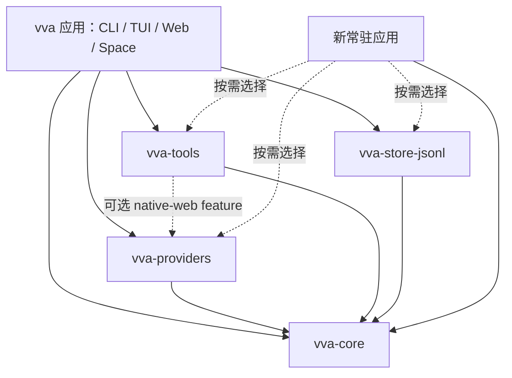

# vva core 拆分方案

状态：待负责人评审的设计提案，尚未实现。基线：2026-11-10，仓库 `vva 1.16.0`。本文区分现状与建议；现有行为的完整说明仍以 [架构](../architecture.md)、[领域模型](../domain_model.md)、[后台任务](../background_tasks.md)、[Agent Space](../agent.md) 为准。

## 1. 结论与范围

建议保留根 package `vva` 作为应用，在 Cargo workspace 中新增 `vva-core`、`vva-providers`、`vva-tools`、`vva-store-jsonl`。**core 负责通用执行机制与存储契约**：它拥有会话、原生元数据、Agent Loop、命令串行化、工具派发、交互请求和异步完成时序；应用决定提示词、启用哪些能力、渠道路由、记忆、定时执行和生命周期策略。

新应用只依赖 `vva-core` 即可实现自己的 provider、工具和存储；需要现成功能时再选择另外三个库。TUI、React Web、QQ、Agent Space 均作为现有 `vva` 的调用方，不成为 core 的依赖，也不成为使用 core 的必要条件。

本轮只提交本文。以下 workspace、API 和迁移命令都是建议，不表示当前仓库已经提供。目标是单进程、Tokio 运行时下的可嵌入库；不同时建设分布式任务平台、动态二进制插件、通用工作流 DSL 或兼容其他项目的协议。“openclaw / hermes 类应用”在本文仅指题述的常驻、多渠道、长期运行应用需求，不假定这些项目的内部实现。

## 2. 现状与依赖调查

### 2.1 当前模块与调用路径

目前只有一个 Cargo package，同时包含库与二进制。[`src/lib.rs`](../../src/lib.rs) 公开全部顶层模块，既是业务模块组织方式，也事实上构成了一个很宽的 Rust API；不存在独立的 core package。

| 模块 | 当前职责与主要调用方 | 建议去向 |
|---|---|---|
| [`model/`](../../src/model/mod.rs)、[`event.rs`](../../src/event.rs) | Session → Turn → Message → ContentPart、供应商强类型元数据、流式事件、后台与 Shell 快照 | 通用数据进 core；展示方法与应用字段单独移出 |
| [`provider/`](../../src/provider/mod.rs) | `Provider`、补全参数、能力声明、Responses / Anthropic / Gemini、HTTP / SSE / WebSocket | 契约进 core；原生实现进 providers |
| [`harness/session/`](../../src/harness/session/mod.rs) | manager 维护句柄，task 唯一修改会话，handle 经命令队列调用，view 经 watch 发布 | 执行机制进 core；应用装配迁到 vva |
| [`harness/agent.rs`](../../src/harness/agent.rs) | 模型寻址、provider 复用、默认工具、联网能力协调、子代理裁剪、标题生成 | 拆成 core 的执行计划与 vva 的装配实现 |
| [`tools/`](../../src/tools/mod.rs) | `Tool` / `ToolRegistry`，文件、编辑、Shell、后台、AskUser、Skill、Agent、消息、联网工具 | 契约与通用运行时句柄进 core；具体工具进 tools |
| [`storage/`](../../src/storage/mod.rs) | `SessionStore` 与 JSONL 实现，兼管 scratch / tool_outputs 目录 | 存储契约进 core，JSONL 进 store-jsonl，工作目录分配退出契约 |
| [`config/`](../../src/config/mod.rs) | 全局 / 项目配置、环境变量、模型配置与预设、`AppState` 偏好、Agent Space 设置 | 文件格式、路径、预设和用户偏好留 vva；协议 / 输入能力类型移到相应库 |
| [`system.rs`](../../src/system.rs)、[`prompts/system.md`](../../src/prompts/system.md)、[`harness/mention.rs`](../../src/harness/mention.rs) | 编码 system prompt、AGENTS.md、技能与 reminder 格式、`@` 文件展开 | vva 的 coding 配方；core 不自动读取或解释 |
| [`agents/`](../../src/agents/mod.rs)、[`skills/`](../../src/skills/mod.rs)、[`discover.rs`](../../src/discover.rs) | agent / skill 文件解析、内置 agent、目录优先级、发现 | 子代理执行定义进 core；可复用解析进 tools；发现路径和内置清单留 vva |
| [`space/`](../../src/space/mod.rs) | IM 启动、router / focus、QQ、附件、记忆 curator、TTL、rollover、定时任务、进度和出站消息 | 留 vva 应用层 |
| [`ui/`](../../src/ui/mod.rs)、[`web/`](../../src/web/mod.rs)、[`frontend/`](../../frontend/package.json)、[`main.rs`](../../src/main.rs) | 终端、HTTP / SSE、React、CLI、日志初始化、更新、进程信号与启动装配 | 留 vva 应用层 |
| [`find.rs`](../../src/find.rs) | TUI 补全与 Web 文件定位共用的工作区搜索 | vva 应用内共享模块，不因多前端共用就归 core |

现有主路径值得保留：

```text
CLI / TUI / Web / Agent Space
  → SessionManager → ManagedSession 的命令队列
  → SessionTask → AgentEngine → Provider / ToolRegistry
  → Turn 持久化；AgentEvent 更新 SessionView
  → TUI / Web 消费 watch 快照，CLI 可消费逐次事件
```

现状没有发现 `harness` 直接调用 ratatui 或 Axum；TUI 也已通过 `SessionView` 消费执行状态。因此不需要另造一套 Agent Loop。问题主要是 package 依赖、应用策略内置，以及少数明确的反向引用。

### 2.2 必须切断的耦合

| 具体位置 | 现有耦合 | 拆分时的处理 |
|---|---|---|
| [`Cargo.toml`](../../Cargo.toml)、[`build.rs`](../../build.rs)、[`web/server.rs`](../../src/web/server.rs) | 单包依赖 ratatui / crossterm / arboard、Axum、rust-embed；构建脚本可能执行 npm，`Assets` 嵌入 `frontend/dist`。即使只引用库的 harness，也会承担此包的构建要求 | 构建脚本和 UI 依赖只属于根应用；构建 core 及三个可选库均不触发 npm |
| [`harness/session/manager.rs`](../../src/harness/session/manager.rs) | manager 持有 `AppConfig`、配置路径、workspace、`state_path`；`open_session` 选择用户上次模型，`remember_session` 写偏好，`reload_config` 读配置；创建会话还创建项目目录 | core 接收显式模型与配方；配置、偏好、创建目录留应用 facade |
| [`harness/agent.rs`](../../src/harness/agent.rs) | `AgentEngine::new` 直接依赖 `AppConfig`，固定装配文件 / Shell / Skill / AskUser / Agent；根据 `agent_managed()` 禁用 AskUser，按 `space::curator::CURATOR_AGENT` 过滤模型可派生 agent | core 执行外部提供的计划；vva 配方显式提供工具、可派生定义、交互模式 |
| [`agents/mod.rs`](../../src/agents/mod.rs) | `builtin_agents()` 调用 `space::curator::curator_agent()`，通用定义发现反向依赖具体应用 | curator 由 Space 装配添加；core 的子代理定义不包含内置清单和 YAML 路径 |
| [`harness/session/task.rs`](../../src/harness/session/task.rs) | `persist_new_session` 读 AGENTS.md、拼 coding prompt、发现 skills / agents；`append_input` 解释 `@`、技能斜杠调用；`commit_tool_results` 按工具名识别 Read 并注入目录 AGENTS.md；还启动标题任务 | 在明确的执行边界调用应用配方，详见 §4.2；自动标题由应用持有任务，重命名时取消，保留现有竞态约束 |
| 同上、[`harness/session/curation.rs`](../../src/harness/session/curation.rs) | 根据 Space header 自动挂 `SetSessionCuration`、每轮更新 Space `last_activity`，共享命令中有 `SetCuration` | curation 工具与标记写入留 Space；活动时间由应用的完成回执驱动，不依赖可能合并的 UI 快照 |
| [`model/session.rs`](../../src/model/session.rs) | `SessionHeader` 含 IM `Origin`、`SessionKind::Curator`、路由来源、TTL、沉淀请求；`agent_managed()` / `supports_curation()` 把应用判定固化为模型方法。`editor`、`web_search` 也承载 coding 装配选择 | 保留通用会话与父子 / 续接关系；应用元数据迁出，存储版本问题单独处理，见 §5 |
| [`harness/session/view.rs`](../../src/harness/session/view.rs)、[`model/background.rs`](../../src/model/background.rs) | `RunState::status()` 返回英文展示文案；`BackgroundTask::label()` 返回中文；后台数据混有 TUI 短暂展示的 `Instant` / `finished_at`；`PUBLISH_INTERVAL` 注释以终端重绘周期解释引擎节流 | core 保留状态、revision、运行时快照与节流机制；文案、脉冲、终态显示五秒等规则归展示层，展示计时字段归应用投影 |
| [`storage/mod.rs`](../../src/storage/mod.rs)、[`tools/mod.rs`](../../src/tools/mod.rs) | 换存储需要实现本地 scratch / tool_outputs 创建；registry 除派发外还知道编辑协议、默认工具和文件落盘截断 | core 的 SessionStore 只管会话；输出保留策略显式配置；目录分配和工作区工具装配归 tools / 应用 |
| [`config/resolver.rs`](../../src/config/resolver.rs)、[`provider/response/request.rs`](../../src/provider/response/request.rs)、[`provider/anthropic/request.rs`](../../src/provider/anthropic/request.rs)、[`tools/filesystem/read.rs`](../../src/tools/filesystem/read.rs) | provider 请求与 Read 反向引用配置中的 `ProviderType` / `InputCapabilities`；resolver 又构造具体 provider | 协议标识与输入能力契约进 core；适配器实现进 providers；AppConfig resolver 留应用，依赖方向变单向 |
| [`provider/http.rs`](../../src/provider/http.rs)、[`provider/websocket.rs`](../../src/provider/websocket.rs)、[`tools/web/zhipu/mcp.rs`](../../src/tools/web/zhipu/mcp.rs) | HTTP / WebSocket 内置 vva 的 OpenRouter 归属头；MCP clientInfo 写 vva 名称与当前包版本 | 库接收显式 `ClientIdentity` / 可选归属信息；vva 应用提供自己的值；不把库的包版本冒充宿主版本 |
| [`tools/shell.rs`](../../src/tools/shell.rs)、[`tools/web/mod.rs`](../../src/tools/web/mod.rs)、[`tools/web/google.rs`](../../src/tools/web/google.rs) | Shell 自动读 `.vva/env`；外置联网工具通过整个 AppConfig 解析凭据、Google 模型等 | 工具接收明确工作目录、env 和已解析 provider / options；vva 在装配处保留自己的配置来源 |
| [`tools/background.rs`](../../src/tools/background.rs)、[`tools/agent.rs`](../../src/tools/agent.rs)、[`system.rs`](../../src/system.rs) | 后台结果回投时调用全局 system reminder 格式，执行机制与模型可见的提示词格式缠在一起 | core 保留完成通知的类型与落盘顺序；模型可见文本由会话配方生成 |
| [`web/api.rs`](../../src/web/api.rs) → [`ui/history.rs`](../../src/ui/history.rs) | Web 为统计 API 引用 TUI 目录下的 `SidebarStats` / `compute_stats` | 先移到 vva 的应用内统计模块；计价与侧栏格式不随之进入 core |

已有的好边界可以继续使用：`Provider`、`Tool`、`SessionStore`、tools 层的 `SessionBroker`、`CompletionSink`，以及 `SessionToolFactory` / `SessionPreamble` 的依赖注入方向。后两者目前只能“追加”，不足以让新应用替换默认编码行为，不能原样充当拆分后的完整 API。

当前权限也需要准确表述：子代理白名单和原生 web 权限协调已经存在，但不是通用执行审批；`Skill.allowed_tools` 明确只解析、不强制；AskUser 是向用户提问，不是工具授权。QQ 用户白名单属于渠道鉴权。拆分不能把三者混称为已有的权限系统。

## 3. 目标 workspace 与公开边界

### 3.1 package 划分

保持根目录的 `vva` package，新增 `[workspace]`、`resolver = "3"` 和 `crates/*` 成员，避免首步搬动 `frontend/`、`build.rs` 和发布打包路径。workspace 的 `default-members` 包含全部成员，使约定的根目录 test / clippy 覆盖所有 crate。

| Package / 位置 | 职责、公开 API | 不应进入的内容 |
|---|---|---|
| `vva-core` / `crates/vva-core` | `model`、`event`、provider / tool / store 契约、会话运行时、交互与授权协议、后台完成追踪；导出 `SessionManager`、`SessionHandle`（现 ManagedSession 的演进）、`SessionSnapshot`（现 SessionView 的演进）、`SessionSetup` 等 | ratatui、crossterm、剪贴板、Axum、React、reqwest / TLS 实现、`.vva` 配置 / 默认路径、coding prompt、渠道类型、定时策略 |
| `vva-providers` / `crates/vva-providers` | 三家原生适配器与 HTTP / SSE / WebSocket；构造器接收连接配置和宿主身份；实现 core `Provider` | AppConfig、默认模型选择、内置产品预设、UI、工具装配 |
| `vva-tools` / `crates/vva-tools` | 文件 / 编辑 / Shell / 输出采集、Skill 文件解析与工具、联网工具、AskUser / Agent / SendMessage / TaskOutput / TaskStop 包装；显式构造器和工作区工具集装配函数 | 自动启用工具、读取用户主目录、Space 的 Schedule / SendFile / SetSessionCuration、渠道授权策略 |
| `vva-store-jsonl` / `crates/vva-store-jsonl` | `JsonlSessionStore::open(root)`、版本化 JSONL 编解码、原子重写 / 追加；实现 core `SessionStore` | 推断 `~/.vva`、分配 scratch / 工具输出目录、执行应用数据迁移策略 |
| `vva` / 根 package | 现有 CLI / TUI / Web / frontend / Space；AppConfig / AppState；`VvaSessionService` facade 与 `VvaSessionSetup`；应用元数据、coding 上下文、技能发现、记忆、router、scheduler、发布与更新 | Agent Loop 的第二份实现 |

四个库分别解决独立消费问题：只用执行引擎不带网络栈；只选原生 provider 不带文件 / Shell 工具；换存储不带 JSONL；现有工具可以被多个宿主采用。暂不再拆 domain、events、三个 provider、TUI、Web 或 scheduler 的独立 crate；那会增加发布矩阵，却没有本次需要的额外隔离收益。

### 3.2 依赖方向

箭头表示“依赖”：



`vva-tools` 的普通外置 HTTP search / fetch 不依赖 providers；Anthropic standalone search 与 Google 原生模型工具需要其原生实现，可用 `native-web` feature 明确依赖，避免复制协议代码。providers 没有反向工具依赖。core 内部模块互用不构成 Cargo 环；所有应用反向引用必须在提取前消除。

core 使用 Tokio、serde、async-trait、thiserror 等现有基础设施；不抽象 executor、channel 或 clock。`serde_json::Value` 只用于确实开放的工具参数 / JSON Schema 等协议边界，不作为供应商元数据或应用状态的扩展袋。

providers 按 `response` / `anthropic` / `gemini` feature 选择，默认不启用；根应用显式开启现有三家。`vva-tools` 的 filesystem / shell / web 等重依赖也由应用显式选择；core 的权限入口不能用 feature 绕开。保留各平台 WebSocket / TLS 配置的真实需求，不借此重做 TLS 技术选型。

库不初始化 tracing subscriber，不注册 ctrl-c，不退出进程，不打印交互文案，不改变 cwd / 进程环境变量。日志由 tracing 发出，宿主负责收集。

## 4. core 的关键 API 与运行语义

以下为边界草图，省略 derive、完整字段和现有便利方法，不是可直接编译的承诺。迁移时优先移动现有实现，只有切断具体耦合所需的接口才改变。所有跨包异步 trait 沿用 `#[async_trait]`，满足 `Arc<dyn Trait + Send + Sync>` 的使用方式。

### 4.1 会话、输入、快照与完成回执

保留每会话一个 SessionTask 的模型：它是会话与存储写入的唯一所有者。不同会话并发；同一会话提交、配置、停止、回退、审批回复经命令队列串行处理。外部只持有句柄与只读快照，不获得 `Arc<Mutex<Session>>` 的任意写权限。

```rust,ignore
pub struct SessionSpec {
    pub model: ModelSelection,       // 宿主已选定的模型 / variant，不猜默认模型
    pub profile: String,             // 宿主解释的配方标识，恢复时必须能解析
    pub workspace: Option<PathBuf>,  // 无文件工具的 agent 可以没有工作区
    pub initial_turns: Vec<Turn>,    // 宿主明确构造的 system / 初始上下文
    pub interaction: InteractionMode,
    // 标题、父子关系等已有通用字段省略
}

pub struct UserInput { pub message: Message }
pub enum InputMode { After, Steer }
pub enum InteractionMode { Enabled, Disabled }

impl SessionManager {
    pub fn new(store: Arc<dyn SessionStore>) -> Self;
    pub async fn create(&self, spec: SessionSpec, setup: Arc<dyn SessionSetup>)
        -> Result<SessionHandle, HarnessError>;
    pub async fn open(&self, id: &SessionId, setup: Arc<dyn SessionSetup>)
        -> Result<SessionHandle, HarnessError>;
    pub async fn live(&self, id: &SessionId) -> Option<SessionHandle>;
    pub async fn close(&self, id: &SessionId) -> Result<(), HarnessError>;
    pub async fn shutdown(&self) -> Result<(), HarnessError>;
}
impl SessionHandle {
    pub fn snapshot(&self) -> Arc<SessionSnapshot>;
    pub fn subscribe(&self) -> watch::Receiver<Arc<SessionSnapshot>>;
    pub async fn deliver(
        &self, input: UserInput, mode: InputMode,
        events: Option<mpsc::Sender<AgentEvent>>,
    ) -> Result<RunTicket, HarnessError>;
    pub async fn abort_current(&self) -> Result<(), HarnessError>;
    pub async fn answer(&self, id: RequestId, answer: InteractionAnswer)
        -> Result<(), HarnessError>;
    // configure / note / rename / fork / revert 等沿用已有能力，省略
}
impl RunTicket {
    pub async fn wait(self) -> Result<RunReport, HarnessError>;
}
```

`deliver` 是现有投递机制的公开化与统一入参，支持文本和领域附件，而非 IM 专属接口。`After` 等当前工作结束，`Steer` 在工具调用与回执配对后的安全边界注入，不在 provider 正在使用的上下文里插入半条消息。原有交互式提交与待发队列操作可以保留为同一执行机制上的 API，忙时语义由方法明确规定，不用 `is_running()` 预检查后再提交。

`RunTicket` 绑定本次投递的完成结果，等待其派生异步工作及自动续跑结束，不靠“下一次全局 Finished”猜归属，也不被后续投递覆盖。`RunReport` 保留最终 `Message`、usage / 轮次定位等结构化数据，文本只是便捷投影；最终回复可能只有图片或没有文本，不由 core 编造占位回答。`AgentEvent::Finished` 仍表示一个模型工作轮结束，不等价于后台工作全部 settled。

事件与快照各司其职：

- `AgentEvent` 是执行中有序增量；provider 产出内容事件，task 补充工具、交互、后台和生命周期事件。工具事件补足 `run_id` / `call_id`，不能仅凭工具名配对并发调用。
- `SessionSnapshot` 保留历史、draft、revision、运行状态、待处理输入、交互请求、后台快照。watch 可以合并中间状态，用于 TUI、Web 或无界面监控；它不是需要逐条执行的业务通知队列。
- 逐次事件使用有界 mpsc；慢消费者产生明确背压，等待发送时仍处理取消 / 停止命令。消费者关闭表示放弃观察，执行继续；停止执行必须发停止命令。以完成回执判断成功，不能把事件流关闭当成功。
- 不建立无界的全局广播总线，不承诺事件跨进程回放。Web 的快照 / delta、UTF-16 偏移和 SSE 重连继续是应用投影，见 [Web 同步协议](../web_sync.md)。
- core 保留合并发布与 Arc 共享能力，默认可沿用现有节流值；不把“终端每 100ms 重绘”变成公开执行契约。通知保存身份 / 类型 / 事实，具体 toast、横幅、状态文案由宿主决定。

`SessionId` / `RunId` / `RequestId` 作为不同领域身份，外部文本在入口解析一次，内部不重复校验其类型已保证的不变量。持久化格式版本属于存储适配器；核心会话不因更换存储而绑定 JSONL 首行版本。

### 4.2 应用装配与上下文：一个有理由存在的新 trait

仅接受一段 system prompt 或一个工具追加工厂不够：vva 还需在模型切换时重组工具、在输入时展开文件 / 技能，在工具执行后加载目录指令。这些代码如果直接移入 core，新应用仍会继承编码产品行为。

建议一个 `SessionSetup`，覆盖这三个已有执行边界，并接管现有异步完成消息格式：

```rust,ignore
#[async_trait]
pub trait SessionSetup: Send + Sync {
    async fn plan(&self, session: &Session, services: &SessionServices)
        -> Result<ExecutionPlan, SetupError>;
    async fn prepare_input(&self, session: &Session, input: UserInput)
        -> Result<PreparedInput, SetupError>;
    async fn after_tools(&self, session: &Session, batch: &[ToolExecution])
        -> Result<Vec<Message>, SetupError>;
    fn completion_message(&self, completion: &TaskCompletion)
        -> Result<Message, SetupError>;
}
pub struct ExecutionPlan {
    pub binding: ModelBinding,
    pub tools: ToolRegistry,
    pub authorizer: Arc<dyn ToolAuthorizer>,
}
pub struct ModelBinding {
    pub provider: Arc<dyn Provider>,
    pub options: CompletionOptions,
    pub inputs: InputCapabilities,
}
pub struct PreparedInput {
    pub before: Vec<Message>, // 追加为用户上下文
    pub message: Message,
    pub after: Vec<Message>,
}
```

core 调用顺序为：prepare_input → 按当次选择生成 plan 并检查输入能力 → 用户上下文 / 输入落盘 → provider → assistant 落盘 → 工具执行与结果配对落盘 → after_tools 返回的上下文落盘 → 下一次 provider。异步完成到达时，用 completion_message 构造用户上下文，与任务终态一起在安全轮隙落盘；格式生成失败也显式报错并保留待消费结果。初始 system / 记忆索引由应用构造 `SessionSpec.initial_turns`，恢复已有会话不重新生成或覆盖它。

`VvaSessionSetup` 负责现有配置解析、技能发现、`@` 和目录 AGENTS.md；`ToolExecution` 保留调用与结构化结果，core 不再比较 `Read` / `hashline_read` 名称。`after_tools` 只能返回供下一次请求使用的用户上下文，不修改已经提交的工具结果。技能刷新仍在实际消费输入时发生，排队期间发生的变化不会因过早预处理而遗漏。

setup 按会话创建，由对应 SessionTask 持有；vva facade 在 create / 冷 open 时构造，关闭后随任务释放。provider 连接缓存、hashline 快照与该会话的工具状态因此可以保存在其具体实现里，不需要一个长期不清理的全局 SessionId → Any 表。manager 的 live 用于取现有句柄，open 仅用于未登记的持久化会话；重复 open 显式报 AlreadyOpen，不偷偷替换活动 setup。profile 是宿主重建配方的依据，core 不自动找 YAML 或配置文件。

`SessionServices` 是会话级具体句柄集合：交互请求、后台登记、输出快照发布、子会话 broker；不是服务定位器，不支持按字符串索取 `Any`。管道读取、ANSI / UTF-8 采集和 hashline 实现仍在 tools；它们经 core 的具体发布句柄提交类型化快照，core 不引用 tools 的采集器。配置 / 工具清单的热替换在安全边界生效；当前 provider 请求使用不可变执行计划。相同会话的同一连接绑定复用 provider Arc，保留 Responses WebSocket 状态；只在真实连接身份改变时重建，不能每次 plan 都重连，也不能在不同会话间共用有单会话状态的连接对象。

这个 trait 的存在理由是让“同一执行引擎”服务现有 coding 配方和新宿主配方。提供具体 `FixedSetup`：固定 binding / registry / authorizer，原样输入、不追加工具后上下文，异步完成按明确的通用任务回执格式生成消息；空上下文是调用方选择的语义。新应用不必逐个实现这些策略方法。暂不增加任意 middleware 链、生命周期 hook 清单、PromptProvider、MemoryProvider 或通用模型 resolver trait。

### 4.3 原生 provider 与强类型信息保真

`Provider` 留在 core，实现留在 providers。保留现有 `name`、`capabilities`、`complete`、`complete_stream` 的职责：

```rust,ignore
#[async_trait]
pub trait Provider: Send + Sync {
    fn name(&self) -> &str;
    fn capabilities(&self) -> ProviderCapabilities;
    async fn complete(&self, session: &Session, tools: &[ToolDefinition],
        options: &CompletionOptions) -> Result<ProviderResponse, ProviderError>;
    async fn complete_stream(&self, session: &Session, tools: &[ToolDefinition],
        options: &CompletionOptions, events: Option<mpsc::Sender<AgentEvent>>)
        -> Result<ProviderResponse, ProviderError>;
}
```

此 trait 支持宿主提供自己的原生适配器，同时避免运行时依赖具体网络栈，不因拆分改变协议。`ResponseTurnMeta`、`AnthropicTurnMeta`、`GeminiTurnMeta` 继续属于 core 的领域存储：`response_id` 与原生 output、cache / thinking signature、Grounding 引用不能退成纯文本或未知 JSON。其结构详见 [领域模型](../domain_model.md)。

`ProviderError` 不能继续通过公开枚举变体强制 core 依赖 reqwest / tungstenite；core 定义协议错误、API 状态码与响应体、传输错误 source 等类别，providers 用 `From` 映射并保留原始错误链。请求失败不改用另一协议，不猜字段别名，不以空正文代替缺失数据。

`ProviderType` 的协议标识与通用 `InputCapabilities` 退出 AppConfig 模块，媒体约束由协议能力明确表达；模型级声明由宿主解析后传入 binding。模型 / 亲和组切换只沿用现有显式、原生协议内的历史重建语义，并保留通知；不借拆分扩展降级路径。新 provider 如果需要保存新的私有状态，应显式扩展领域类型及格式版本，不用 `HashMap<String, Value>` 偷渡。

HTTP client / 连接池仍可在 providers 内复用。宿主归属头通过具体配置传入，不为此抽象 HttpTransport trait。原生服务端工具由 provider 执行，必须在执行计划中明示；不能把 API 返回的同名客户端调用当作原生成功执行。

### 4.4 工具注册与执行

保留 `Tool` 的现有基本形态与 `ToolInput::{Json, Freeform}`，包含结构化 `ToolResult`、媒体、后台身份与 Shell 输出。工具可以通过构造器捕获宿主的具体服务或 `SessionServices` 句柄；不要求所有工具实现文件路径、Shell 或渠道接口。

```rust,ignore
#[async_trait]
pub trait Tool: Send + Sync {
    fn name(&self) -> &str;
    fn description(&self) -> &str;
    fn input(&self) -> ToolInput;
    async fn execute(&self, arguments: &str) -> Result<String, String>;
    // 沿用 execute_call / execute_result 等现有结构化执行方法
}
impl ToolRegistry {
    pub fn new() -> Self; // 空注册表是明确的合法状态
    pub fn register(&mut self, tool: Arc<dyn Tool>) -> Result<(), RegistryError>;
}
```

这个 trait 是现有自定义工具边界，不另加 ToolExecutor。registry 只负责定义、查找、调用形态校验、结果关联与显式执行错误；重复工具名 / 与原生保留名冲突直接报错，不覆盖。`with_editor` / `with_workspace_tools` 转移到 tools 的装配函数，core 不自动注册任何工具。

工具参数是外部协议数据，必须解析并报告缺字段、非法类型、未知工具、freeform 文法错误；这不是防御式重复校验。类型内部已确定的调用 / 回执对应关系不再用默认值兜底。

Skill 解析迁移时保留仓库已有的特定例外：SKILL.md 未知 frontmatter 字段或非字符串 metadata 告警后忽略，仍加载技能；其余规范字段继续严格校验。这个例外不推广到 provider、工具入参或会话数据。

并行工具执行保留，结果按模型调用顺序提交。取消时为未完成调用记录明确的中止结果，保持 tool_call / tool_result 配对；不把取消记为成功。输出截断与保存通过具体 `OutputRetention` 配置表达：明确内联预算，或明确本地输出目录。选择纯内联时超限显式报错；选择文件保留时写失败显式报错，不临时切换另一种方式。暂不抽象远程对象存储 trait。

### 4.5 存储契约与应用元数据

`SessionStore` 是必需的替换边界，理由是新应用可能使用自己的数据库，而不仅是不同 JSONL 根目录。首版保留当前“以 Session 重写头及现有历史”的语义以支持 fork / revert，名称应明确其全量替换效果：

```rust,ignore
#[async_trait]
pub trait SessionStore: Send + Sync {
    async fn save_session(&self, session: &Session) -> Result<(), StoreError>;
    async fn append_turn(&self, id: &SessionId, turn: &Turn) -> Result<(), StoreError>;
    async fn load_session(&self, id: &SessionId) -> Result<Option<Session>, StoreError>;
    async fn list_sessions(&self) -> Result<Vec<SessionSummary>, StoreError>;
    async fn delete_session(&self, id: &SessionId) -> Result<(), StoreError>;
}
```

`save_session` 是现 `save_header` 的明确命名，不缩成“只更新 header”后悄悄丢失 fork / revert 的历史重写能力。成功表示该调用负责的数据已经写入其持久化介质；替换要么完整可见，要么保留旧状态。JSONL 继续遵循 [现有追加与原子重写语义](../storage.md)，不把当前的 flush 宣称为跨断电事务保证。

`Ok(None)` 仅表示不存在；损坏、版本不符、数据库故障返回错误。`StoreError` 保留错误类别与 source，允许自定义后端报告自身错误，不被迫伪装为 IO。一次会话由一个运行时写入；本次不承诺多进程并写，也不增加分布式锁。

删除 `ensure_scratch` / `ensure_tool_outputs`：应用或工具装配在需要时准备路径并传给工具 / prompt。JsonlSessionStore 不再因保存一个无工具会话而创建这些目录。自定义存储不需要返回本地路径，也不需要实现虚假的文件系统方法。

应用数据按 SessionId 关联，仍用强类型。例如 vva 的 `SpaceSessionRecord` 存 `kind / origin / routed_by / ttl_secs / last_activity / curation_requested`；coding 会话配置存编辑协议与 web 选择。`continued_from` / `superseded_by` 是通用续接关系，可留 core，但是否触发压缩、如何生成摘要、何时切换 focus 均由应用决定。

core 不携带 `Origin`、QQ binding、curator 枚举或任意 JSON 扩展字段。应用创建 Space 会话时先准备配置与关联记录，再向渠道公开可路由会话；关联记录缺失 / 不合法直接报错，不能推断它是普通会话或自动补建。删除会话时先移除路由可见性，再删除 core 数据与应用记录；失败保留明确清理错误与待处理记录。跨两种存储不宣称原子事务，应用启动时显式核对并报告不一致，不自动删除或猜测修复。

### 4.6 权限、审批与提问

新增 `ToolAuthorizer`，理由是常驻宿主必须能在任何工具副作用发生前介入，工具清单裁剪不能表达一次调用的批准。它只负责本次调用决策，不承担渠道鉴权、沙箱或角色权限语言。

```rust,ignore
#[async_trait]
pub trait ToolAuthorizer: Send + Sync {
    async fn authorize(&self, session: &Session, call: &ToolCall)
        -> Result<Authorization, AuthorizationError>;
}
pub enum Authorization {
    Allow,
    Deny { reason: String },
    RequestApproval { reason: String },
}
pub enum InteractionRequest {
    Approval { id: RequestId, call: ToolCall, reason: String },
    Question(UserQuestionRequest),
}
pub enum InteractionAnswer {
    Approval(ApprovalDecision),
    Question(Vec<UserAnswer>),
}
pub enum ApprovalDecision { AllowOnce, Deny { reason: String } }
```

先按配方限制工具能力，再解析调用、授权、等待必要批准，最后执行。批准绑定 session / run / call 与确切参数，只消费一次；错误请求身份、已结束请求、答复类型不符都显式报错。拒绝形成与该调用配对的错误结果；授权服务故障是执行错误，不自动批准。core 没有隐式 allow-all；vva 若维持当前直接执行行为，需要在装配中明确选择允许策略，并在变更说明中写清。

交互请求进入标准事件与 snapshot，回复走会话命令；core 不认识弹窗、HTTP endpoint 或 IM 回复格式。工具并行时，审批按请求身份登记，不能用一个全局 oneshot 让后一次覆盖前一次。等待批准时仍可停止当前执行；停止使尚未消费的批准失效。AskUser 可以先保持现有单活跃问题语义，不顺便扩大其并发能力。

`InteractionMode::Disabled` 必须显式提供；此时不注册 AskUser，授权策略若返回 RequestApproval 则返回明确的“此会话不可交互”错误，不悬挂、不选默认答案。支持 IM 问答的新宿主可选择 Enabled；不能再通过“来自 IM”推断无人交互。

原生服务端工具的副作用发生在 provider 请求内部，不能冒充已经过逐次本地审批。计划生成时必须为启用的原生能力取得会话级明确授权；如果宿主要求逐次批准，则不声明该原生能力，或明确选择支持该控制的另一种客户端工具。Responses 的 search 同时涵盖 fetch 等已有捆绑权限约束需要保留。此处不提供 Shell 沙箱承诺。

### 4.7 后台任务、子代理、长时间运行与关闭

core 保留后台登记、完成回投、结果持久化与自动续跑机制；Shell 进程执行 / 输出采集在 tools；计时到点则属于应用 scheduler。这三者不能合成一个含渠道与 cron 的 BackgroundService。

建议从当前 Shell 与子会话完成追踪提取具体句柄，不再加执行器 trait：

```rust,ignore
impl BackgroundHandle {
    // 将自定义异步工具工作登记为本会话的任务，返回身份。
    pub fn spawn(
        &self, owner: ToolCallId, description: String,
        work: impl Future<Output = Result<TaskCompletion, TaskError>> + Send + 'static,
    ) -> Result<TaskId, TaskError>;
    pub async fn stop(&self, id: TaskId) -> Result<(), TaskError>;
}
```

`TaskCompletion` 是有类型的结果 / 状态 / 输出，任务来源以工具调用或子会话身份表达，不要求所有任务伪装为 Shell / Agent。Shell 专属退出码和输出快照仍可作为明确类型保留，不退成任意 JSON。任务进度只更新观察状态，完成才进入模型调度；取消 future 时，工具必须通过其资源所有权结束进程或连接，不能只丢弃 JoinHandle。

必须保持 [后台任务的时序约束](../background_tasks.md)：

1. 完成可能早于启动回执；终态不能被较晚的 Running 覆盖。
2. 完成结果经可靠命令队列进入 SessionTask，在调用 / 回执配对后的安全轮隙落盘，落盘成功才确认消费，再自动续跑。
3. 停止或 provider 错误暂停自动续跑，已经到达的结果仍持久化；新输入恢复调度。暂停与完成不是同一状态。
4. 完成回执绑定本次工作，包含子代理和后台工作；watch 更新被合并不影响业务结果。
5. 任务属于进程 / 会话；重启后运行中的历史快照标 Interrupted，不重放 Shell 或网络副作用。

现有 `SessionBroker` 保留为 tools 调用 core 子会话编排的边界，类型移到 core：派生子代理、跨会话投递、等待、停止；具体实现仍由 manager 提供。它的理由是 tools package 不能依赖 manager 内部命令协议。派生入参由可序列化的子代理定义与运行期 setup 分开组成；Agent 工具在构造时接收宿主的子会话 setup 工厂闭包，再把明确的 spec / setup 交给 broker，不让 core 回调 vva 的 discover_agents。子代理配方、可用工具集合和最大深度由宿主明确配置，子代理权限不得超出父会话授权范围；继承约束在 core 的派生路径执行，不能只藏在 Agent 工具提示词里。curator 只是 Space 显式提供的系统配方，不是 core 的特殊名字。

授权继承不比较两个 authorizer trait 对象的“权限大小”：派生路径保留父授权约束，子会话调用必须同时通过继承约束与自己的授权策略。父会话对某次调用的 AllowOnce 不会变成子会话的通行证；原生工具声明也要受继承约束，不能绕过本地工具授权。

当前 manager 主要持有已登记句柄，任务又持有弱命令 sender，现有 Space 退出主要 abort 外层任务。库化后必须增加明确生命周期：`close` 停止该会话并等待结束、保留历史；`delete` 与其语义分开；`shutdown` 先拒绝新命令，取消未完成交互 / 前台派生与登记的后台工作，等待任务退出并冲刷已完成结果，返回持久化 / 清理错误。宿主决定等待多久、何时强制结束进程；core 不注册进程信号，也不提供无限期“自动修复”循环。

不自动淘汰活跃会话。常驻应用按自己的空闲策略调用 close，解决句柄常驻内存的问题；需要时再 open。首次版本不实现持久化任务队列、跨进程恢复执行、自动重试非幂等工具或进程监督器。需要可靠渠道收发时，宿主提供 inbox / outbox、平台 message id 去重与重试；core 的接受回执不等于渠道消息已可靠投递。

### 4.8 trait 数量与边界理由

| Trait | 为什么需要 | 不为它新增的层 |
|---|---|---|
| `Provider`，保留 | 三个现有原生实现及宿主实现共享调用边界 | 不抽象 HTTP / SSE transport，不退化成 chat completions |
| `Tool`，保留 | 现有工具与宿主自定义工具的执行边界 | 不再套 ToolExecutor 或动态插件 ABI |
| `SessionStore`，收窄 | JSONL 与新应用数据库需要替换 | 不要求目录分配，不拆每种 CRUD 的 repository |
| `SessionBroker`，移动 | 可选工具包需要子会话能力，但不依赖 manager 内部 | 不造通用 actor / RPC 框架 |
| `SessionSetup`，新增 | 替换已存在的装配、输入处理、工具后上下文、异步完成消息策略 | 不扩成任意 hook / middleware 系统 |
| `ToolAuthorizer`，新增 | 对真实副作用执行前的宿主授权与一次批准 | 不建立权限 DSL、身份平台或沙箱框架 |

事件通道、交互句柄、后台追踪、输出保留均用具体类型。Channel / Router / Curator 的现有 trait 留在 vva；出现第二个独立消费者且需要共享相同语义时，再考虑单独的可选应用组件库。

## 5. 会话格式与应用数据迁出

不能一边从 SessionHeader 删除 Space / coding 字段，一边宣称现有 v2 JSONL 无变化。也不能直接忽略旧字段，下一次重写时静默丢失 origin / TTL / 沉淀标记。

建议将“物理拆包”与“领域格式净化”分开：

- 搬迁契约和实现期间暂时保留原 v2 DTO 和所有字段，保留序列化形态；它是明确的迁移中间状态，尚不对外宣布 core API 稳定。
- 应用行为退出 runtime 后，在独立一步把通用 Session、SpaceSessionRecord、coding 配置分开；JSONL 新布局使用显式的新版本，建议 v3。应用记录也有自己的 schema version。带 workspace 的已有会话保留其确切路径，无工作区的新会话可采用按 SessionId 分配的目录，不猜 cwd。
- 若负责人接受提供一次性迁移，建议 `vva session migrate --from-version 2 --source ... --destination ...`：要求停写，严格读取已知 v2，保留原 SessionId / turns / provider meta / 工具快照，将应用字段写到对应强类型记录；检查绑定、父子 / 续接引用。未知版本或损坏数据立即报错。
- 迁移写入新的目标根目录，失败不改源目录；全部完成并核对后，用户显式切换根目录。不要在多个文件间声称原子提交；用整体新目录加迁移清单记录完整结果。原始目录可用于退回旧二进制，不能让旧二进制打开新格式。
- 历史中的 scratch / 大输出路径与文件也必须有去向：会话存储根目录分离后，vva 显式配置原有 artifact 路径并继续保留文件；不能只搬 JSONL 就删除旧目录。迁移不搜索替换任意对话文本里的路径。若以后要搬 artifact，另做引用迁移，不在拆包时猜测文本含义。
- 新运行时加载旧格式返回带路径与版本的错误，不隐式迁移、转纯文本或加载空历史。列表也应明确报告有不支持的数据；不能以“列表成功”隐藏仍未迁移的会话。

一次性迁移是明确的版本转换，不是 provider / runtime 中的 fallback。若负责人选择遵循当前“旧版本不解析”的方式、不提供迁移命令，就必须在发布说明中明确旧数据需要留给旧版本读取，并在切换前完成数据处置；不能等发布后才决定。此决策阻塞 §7 的格式变更步骤，不阻塞前面的依赖整理。

## 6. 新常驻应用如何组装

### 6.1 只依赖 core 的最小草图

下例仅依赖 `vva-core` 与 Tokio / async-trait / serde 等基础库，不依赖 vva 应用。`provider` 和 `store` 是宿主注入的 `Arc<dyn Provider>` / `Arc<dyn SessionStore>`：可分别用宿主自己的原生网络适配器与数据库实现；后者只需实现 §4.5 的五个方法，不需要本地工作目录。

示例为单会话、After 顺序输入；渠道消息通过本地 mpsc 传入。平台鉴权、message id 去重、路由到多个 SessionId、附件下载由宿主在此边界外处理。为能继续接收消息，等待完成 / 回复和入站循环分别执行；生产宿主还应将进程信号加入同一主循环并调用 shutdown。

```rust,ignore
use std::sync::Arc;
use async_trait::async_trait;
use serde::Deserialize;
use tokio::{sync::mpsc, task::JoinSet};
use vva_core::{
    FixedSetup, SessionManager, SessionSpec, ModelBinding,
    ModelSelection, InteractionMode, InputMode, UserInput,
    Provider, SessionStore, Tool, ToolRegistry, ToolInput, AllowTools,
    CompletionOptions, InputCapabilities, Message, Turn, Role,
};

struct Echo;
#[derive(Deserialize)]
#[serde(deny_unknown_fields)]
struct EchoArgs { text: String }

#[async_trait]
impl Tool for Echo {
    fn name(&self) -> &str { "Echo" }
    fn description(&self) -> &str { "Return the supplied text." }
    fn input(&self) -> ToolInput {
        ToolInput::Json(serde_json::json!({
            "type": "object", "properties": {"text": {"type": "string"}},
            "required": ["text"], "additionalProperties": false
        }))
    }
    async fn execute(&self, arguments: &str) -> Result<String, String> {
        let args: EchoArgs = serde_json::from_str(arguments)
            .map_err(|e| format!("Echo arguments: {e}"))?;
        Ok(args.text)
    }
}

struct Inbound { reply_to: String, input: Message }
struct Outbound { reply_to: String, messages: Vec<Message> }
type Error = Box<dyn std::error::Error + Send + Sync>;

async fn serve(
    provider: Arc<dyn Provider>, store: Arc<dyn SessionStore>,
    selection: ModelSelection, options: CompletionOptions, inputs: InputCapabilities,
    mut incoming: mpsc::Receiver<Inbound>, outgoing: mpsc::Sender<Outbound>,
) -> Result<(), Error> {
    let mut tools = ToolRegistry::new();
    tools.register(Arc::new(Echo))?;
    let setup = FixedSetup::new(
        selection.clone(), ModelBinding { provider, options, inputs }, tools,
        Arc::new(AllowTools::new(["Echo"])?), // 明确仅允许这个客户端工具
    );
    let manager = SessionManager::new(store);
    let session = manager.create(SessionSpec {
        model: selection, profile: "personal".into(), workspace: None,
        initial_turns: vec![Turn::new(Role::System, vec![Message::text("你是个人助手。")])],
        interaction: InteractionMode::Disabled,
        // 其余通用会话字段省略
    }, Arc::new(setup)).await?;
    let mut replies = JoinSet::<Result<(), Error>>::new();

    // 返回运行错误前也执行 shutdown；不靠退出进程回收内部任务。
    let result: Result<(), Error> = async {
        loop {
            tokio::select! {
                message = incoming.recv() => {
                    let Some(message) = message else { break; }; // 入站正常关闭
                    let ticket = session.deliver(
                        UserInput { message: message.input }, InputMode::After, None,
                    ).await?;
                    let output = outgoing.clone();
                    replies.spawn(async move {
                        let report = ticket.wait().await?;
                        output.send(Outbound {
                            reply_to: message.reply_to, messages: report.messages,
                        }).await?;
                        Ok(())
                    });
                }
                finished = replies.join_next(), if !replies.is_empty() => {
                    finished.expect("JoinSet has a task")??;
                }
            }
        }
        while let Some(finished) = replies.join_next().await { finished??; }
        Ok(())
    }.await;
    let stopped = manager.shutdown().await;
    match (result, stopped) {
        (Ok(()), Ok(())) => Ok(()),
        (Err(run), Ok(())) => Err(run),
        (Ok(()), Err(stop)) => Err(stop.into()),
        (Err(run), Err(stop)) => Err(format!("run: {run}; shutdown: {stop}").into()),
    }
}
```

这是 API 草图，`SessionSpec` 部分字段和宿主 provider / store 的具体实现没有展开；不应复制进仓库当作已通过编译的示例。示例的 Echo 用于展示注册边界，真实业务工具可在构造器里接收宿主数据库 / 服务。`FixedSetup` 必须拒绝不匹配的模型选择，而非忽略切换请求。恢复已有会话时使用同一 profile 的 setup 后调用 open，不重新创建 initial_turns。

需要观察时，直接 `session.subscribe()` 获得状态；需要逐次内容时给 deliver 传有界事件 sender，并与 `ticket.wait()` 并行消费。两者均不需要终端或 HTTP。`AllowTools` 不启用原生服务端工具；若要用它们，应在配方中显式授权相应能力。

### 6.2 扩展点落位

| 新应用需求 | 用什么组合 | core 不决定什么 |
|---|---|---|
| 多渠道接入 | 宿主 adapter → typed Message / ContentPart → SessionId 路由 → deliver；结果 / 交互回复映射回平台 | 平台身份、群聊规则、去重、binding / home、消息长度与发送重试 |
| 自定义工具 | 实现 Tool，在 setup 中注册；构造器传业务服务；需要异步工作时用 BackgroundHandle | 不扫描插件目录、不自动挂 Shell、不默认开放渠道发消息工具 |
| 自定义持久化 | 实现 SessionStore，并独立保存宿主渠道 / 记忆等元数据 | 不要求文件夹、JSONL 或 vva 配置；不宣称跨存储事务 |
| 原生模型调用 | 注入自有 Provider，或选择 vva-providers 某个 feature | 不做协议兼容猜测、默认模型选择或失败后换供应商 |
| 无 UI / 有 IM 问答 | 选择 Disabled 或 Enabled，宿主处理 InteractionRequest 并 answer | 不因“无窗口”就自动批准，不因“IM”就移除交互能力 |
| 记忆与技能 | 宿主生成 initial_turns / note / prepare_input 上下文，显式选择技能目录与可用工具 | 不强制 `MEMORY.md` 层级、git commit、curator prompt 或 `.vva` 目录 |
| 定时执行 | 宿主 scheduler 生成 UserInput，选择已有或新会话，再 deliver | cron 时区、错过是否补跑、并发策略、通知到哪个聊天 |
| 长上下文与清理 | 宿主读 usage / 关系，生成摘要，创建接替会话；空闲后 close / 删除 | 何时 rollover、TTL 多长、清理前是否沉淀 |

现有 scheduler 的 Task 含 `session` / `bindings`，interval 从完成起算，停机错过上报不补跑；curator 带 vva 提示词、记忆目录和 git 提交；rollover 会复制前缀、压缩并切 focus。这些均为现有应用的有效策略，留在 Space，不为了“长期运行”四字搬进 core。新应用初期可在自己代码中复用思路；真要共享时，再将已去渠道耦合的实现提为独立可选组件，不能让 core 反向依赖它。

## 7. 可独立合并的迁移步骤

原则：先在单包内切断依赖，再物理移动；数据格式与审批行为各自单独评审。每一步完成后仓库都应编译，现有应用仍可使用；不保留两份 Agent Loop，不在半迁移时删字段。

所有步骤的公共检查：

```sh
export PATH=$HOME/.cargo/bin:$PATH RUSTFLAGS=-Cdebuginfo=1
cargo test
cargo clippy --all-targets -- -D warnings
```

workspace 出现后再显式执行 `cargo test --workspace` 与 `cargo clippy --workspace --all-targets -- -D warnings` 核对覆盖范围。优先搬原有测试；只有新增顺序、并发、协议边界或真实回归且原测试未覆盖时补最小测试，不为 re-export、serde 字面量或默认值补测试。

| 步骤 | 改什么；合并后的可用状态 | 主要风险与验证 |
|---|---|---|
| 0. 确认边界 | 审阅本文，确认 API / 旧会话处理 / 发布策略。此步仅新增本文，不改版本 | 防止将中间状态当成已可公开依赖的 core |
| 1. 消除明显反向依赖 | 单包内把 Web 共用统计移出 ui；curator 改由 Space 显式装配；把协议 / 输入能力从 AppConfig 的归属中剥离；宿主身份可注入 | 检查 provider 请求、WebSocket 和 MCP 身份一致；沿用相关 provider / stats / router 测试，不重写 UI |
| 2a. 抽出运行配置 | 单包内引入 ModelBinding / ExecutionPlan 与 setup.plan，vva 解析 AppConfig 并装配工具；manager 的模型偏好 / 配置重载进 `VvaSessionService`。旧调用点全部改用 facade | provider Arc 复用、换模、subagent 工具白名单及 web 捆绑权限易变；已有测试继续覆盖，不每次 plan 重建 WebSocket |
| 2b. 抽出上下文策略 | prepare_input / after_tools 接管技能、`@`、目录 AGENTS.md、reminder；初始上下文、自动标题和 Space 标记由应用持有。运行时保留命令与安全轮隙 | 最容易出现重复注入、顺序变化、标题覆盖重命名。搬现有测试；仅针对未覆盖的实际顺序回归补测试 |
| 2c. 收窄存储职责 | save_header 明确为 save_session；scratch / tool_outputs 路径由应用分配；工具接收明确 env / provider 配置；此时 v2 数据不变 | fork / revert 全量历史重写与大输出引用不能丢失；沿用 JSONL 原子重写、工具输出与回退测试 |
| 2d. 切断具体工具资源依赖 | 在单包内把 hashline 状态归到每会话 setup；管道 / 进程采集归工具；task 只持有通用后台登记、完成消费与输出快照入口。实现 BackgroundHandle 与 completion_message，先维持现有执行语义 | 这是 runtime 提取前置条件，不能让 core 仍引用 tools::BackgroundTasks / ShellOutputs / HashlineSession。沿用后台早完成、回执与取消测试核对顺序 |
| 3. 建 workspace，先提契约 | 新建 core，只搬模型、事件和各 trait / 通用类型；根包暂时 re-export 原路径，实际运行时仍在根包。default-members 覆盖全部成员 | 不出现两种同名领域类型；旧 re-export 仅作迁移兼容，不做运行时适配。core 无应用和网络依赖；允许测试所需 dev-dependencies |
| 4a. 提 JSONL | JSONL 实现进 store-jsonl，根包用 re-export 维持旧路径；删除原实现 | 本步不改布局和版本；原存储测试随实现搬移 |
| 4b. 提 providers | 原生实现、传输和测试进 providers；配置 resolver 仍在 vva，依赖 providers + core | 三家 metadata / 缓存 / 签名 / response_id / 引用、SSE / WebSocket 原有测试通过；本步不改协议 |
| 4c. 提 tools | 具体工具、显式目录的 skill 解析进 tools；发现优先级、内置 agent、Space 专有工具留应用；按需启用 native-web | hashline 会话快照、Shell 后台清理、媒体输入能力与大输出最易受影响；沿用对应测试；tools 不再依赖 vva config / system / space |
| 5. 提运行时 | 已去应用行为的 manager / task / handle / snapshot 进 core；broker 契约在 core，包装工具在 tools，循环消失；移除重复实现。vva facade 适配所有入口 | 执行过程中取消、Steer、后台早完成、自动唤醒、独立回执不能改变；搬现有 harness 测试。此时外部可试用，v2 DTO 仍是暂存边界 |
| 6a. 元数据净化 | 按 §5 已批准决策调整 core 模型、vva 应用记录与 JSONL v3；选择迁移时，迁移工具与可切换目标根目录支持同一步完成；删掉旧 Space runtime 命令 | 元数据与 core 双写不一致、旧会话不可读。以一项真实 v2→v3 转换保真 / 失败不改源的集成测试补迁移边界；不堆 serde 格式测试。此步允许明确的格式破坏，但应用和测试必须一起完成 |
| 6b. 展示净化 | 状态 label、终态展示计时移到应用投影；UI / Web / Space 从类型映射展示；不改事件驱动原则 | Web 协议不直接暴露新版 Rust 模型；现有 snapshot / delta 与 TUI 测试必须通过，不能用历史覆盖界面的补丁修复 |
| 7a. 明确生命周期 | 在步骤 2d 的通用任务登记上增加 close / shutdown 与完整受管任务回收；公开投递 ticket，保留现有安全轮隙顺序 | 针对未覆盖的关闭清理、完成早于回执、停止后持久化 / 不续跑选必要最小测试；不声称任务跨进程存活 |
| 7b. 加授权与交互边界 | 引入 ToolAuthorizer，现有 vva 显式选择策略；审批请求走标准事件 / snapshot 与命令，替换 agent_managed 禁用 AskUser 的推断 | 核验拒绝不产生副作用、停止使批准失效、Disabled 不等待；只补相应状态转换测试。原生服务端工具按会话级授权处理 |
| 8. 外部消费验收与 API 收口 | 新增仅依赖 core 的 headless 示例 / smoke 消费包；公开文档，移除临时 re-export，review 全部 pub / feature / 包发布文件；更新后续 code_map 等现状文档 | 用外部目录依赖构建证明不需要 Node / UI；Rust API 破坏按版本规则处理。本轮不执行这些后续代码 / 文档修改 |

步骤 4a / 4b / 4c 只在前置契约稳定后各自合并；它们之间没有必需的合并顺序，tools 的 native-web 部分依赖 4b。每次合并删除迁移后无用的旧模块与 helper；不为维持旧架构添加跨 crate 回调转发链。

### 7.1 验收重点

最终验收不止是根应用能编译：

- `cargo tree -p vva-core -e normal` 中没有 ratatui / crossterm / arboard / axum / rust-embed、reqwest / TLS 实现或根 package；三个库均不依赖 vva。
- 在独立目录通过 path 或发布版本依赖 core，构建 headless 示例；仅正常依赖图需要不含 UI，provider mock 测试可继续使用 Axum dev-dependency，不因此再造传输 trait。
- 能分别选择自定义 provider / store、自定义工具或完全空工具集；仅 core 路径不需要 Node、frontend/dist、HOME 下 vva 配置或一个工作目录。
- 原生协议与存储保真测试迁移通过；TUI / Web 的快照、后台输出、引用与回退行为保留。相关步骤同时运行现有 frontend 构建及同步测试，命令见 [Web 同步验证](../web_sync.md)。
- 关闭后无被 manager 遗留的活动任务，取消 / 审批 / 后台完成的关键顺序有证据；事件关闭、任务完成、持久化成功的语义分别明确。

### 7.2 版本与 CHANGELOG

当前根 package 是 `1.16.0`、会话格式是 v2；两者不是同一个版本轴。本轮只增设计文档，不修改 Cargo.toml、Cargo.lock 或 CHANGELOG。

建议四个新库从共同的 `0.1.0` 开始，在应用接入与外部消费验收前明确为未稳定 API；库之间先同步版本，依赖写准确的 `path + version`，不把应用 `1.x` 版本直接当 core 稳定性承诺。crate 名是否可发布须在发布前核实，本文未假定已占用名称可用。

根 `vva` 在仅搬迁且 re-export 保持 API 时可以继续当前版本开发，不要求每合并一步都打版本。删除旧公开路径、移出 SessionHeader 字段以及默认授权行为变化必须作为公开破坏处理；建议首次正式拆分发布根应用 `2.0.0`。新库处于 0.x 时，破坏 API 按 minor 升级并同步其相互依赖；是否长期同步版本见 §8。

实际发布时才更新对应 manifest 与 lock：根 CHANGELOG 增加与应用 tag 完全一致且非空的条目，说明行为、Rust API、格式、迁移 / 回退方式、库的初始版本。新增库的变更先在同一 CHANGELOG 按 package 标注，不先复制四份历史。

现有 [release workflow](../../.github/workflows/release.yml) 由 `v*` tag 打应用构件和 Release，尚无 crate 发布步骤；workspace 后应用构建应明确 `-p vva`，确保仍打包原二进制。库若发布，按 core → providers / store-jsonl → tools 的依赖顺序检查包内容、版本约束和打包验证，应用继续独立发布。不要让库 tag 误触发应用 Release；公开发布与自动化策略需负责人确认。迁移实施也不意味着本轮获准 commit、push 或发 tag。

## 8. 需要负责人拍板的问题

以下给出推荐取舍，避免把开放问题留成无结论的需求清单；不确定的部分不由实现者用 fallback 补齐。

| 问题 | 推荐 | 另一种选择及代价 |
|---|---|---|
| 首版 core 的范围 | 本文五 package，scheduler / router / memory 留应用；只复用执行与会话机制 | 同时提“个人 agent 平台”会把渠道、记忆与调度策略稳定成公共 API，扩大范围与验证成本 |
| 旧会话处理 | 接受独立的 v3 变更，并提供显式、写新目录的一次性迁移 | 不提供迁移可减少代码，但旧 v2 会话必须使用旧版本读取；不能默默丢字段或只忽略旧会话 |
| 首次公开版本与路径兼容 | 应用 2.0.0，四库 0.1.0；中间 re-export 在 major 边界移除，短期库同步版本 | 长期保持 `vva::*` 兼容会把应用包继续变成库入口；四库独立版本可更灵活，但发布管理更复杂 |
| 授权的首版产品行为 | core 必须接显式 authorizer；vva 保持行为时明确允许策略，新常驻应用自行选择 | 若要求 vva 默认逐次审批，需要同时设计 TUI / Web / IM / CLI 的产品流程，应作为独立行为变更，不能夹在目录移动里 |
| 原生工具与逐次批准 | 明确区分会话级原生能力授权与本地逐次执行授权；需要逐次批准时不启用不可拦截的原生能力 | 宣称同一 authorizer 覆盖服务端每次调用并不真实；换成客户端工具会影响原生能力与提示，必须由应用明确选择 |
| 长期运行可靠性承诺 | 首版只做进程内执行、明确关闭与历史恢复；渠道可靠性 / inbox / outbox 由宿主承担 | 若首个新应用就要求停机恢复后台任务、至少一次投递、幂等重放，需要单独的数据与副作用设计，不能仅加 retry |
| crate 分发与许可 | 先作为同仓 workspace / Git 或 path 依赖验证，确认后再公开发布；暂沿用仓库声明的 `AGPL-3.0-only` | 若目标是不同授权条件的下游，负责人需先决定许可安排；拆包本身不代表许可已改变，本文不作法律结论 |
| 首个下游的共享深度 | 先用 headless 消费者验证 API，再由真实下游提出共享的渠道 / scheduler 需求 | 先为假想的多个下游抽 trait 容易固化 vva 的 focus / memory 约定，后续又需兼容或破坏 API |

评审通过的标志应是：core 的每个公开类型都有明确职责，应用能替换装配与持久化且不继承 vva 产品策略，旧数据去向与权限行为已有明确决策；并非仅仅出现了 `crates/vva-core` 目录。
