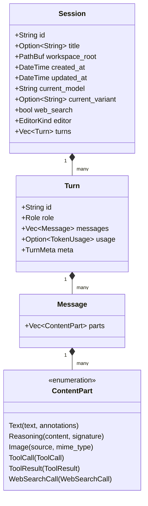

# 领域模型与强类型体系 (Domain Model & Strict Typed Metadata)

## 1. 四层级联领域模型

vva 采用四层实体架构组织会话生命周期与历史数据：

$$\text{Session} \longrightarrow \text{Turn} \longrightarrow \text{Message} \longrightarrow \text{ContentPart}$$



### 1.1 Session（会话根实体）与 SessionHeader
- **代码位置**：[`src/model/session.rs`](../src/model/session.rs)
- **核心职责**：
  - 作为交互的历史上下文边界；
  - **绑定当前生效模型、推理强度与网络搜索开启状态**：
    - `current_model: String`（如 `"openai/gpt-5-terra"` 或 `"anthropic/claude-3-7-sonnet"`）；
    - `current_variant: Option<String>`（如 `Some("high")` 或 `None`）；
    - `web_search: bool`（保持工具/函数挂载与 prompt cache 一致）；
    - `version: u32`（会话格式版本，当前 `SESSION_VERSION = 2`；版本不符的会话不解析）；
    - `editor: EditorKind`（`hashline` / `replace` / `patch`，创建时取当时模型 `annotation.editor`，未声明时取 `settings.editor`，缺省 `patch`；会话内换模不改写，以保证文件工具协议与历史工具结果一致）。各协议注册的文件工具名互不重叠：`replace` 为 `Read` / `Write` / `Edit` / `Glob` / `Grep`；`patch` 为 `Read` / `apply_patch`（Codex V4A，freeform）/ `Glob` / `Grep`；`hashline` 为 `hashline_read` / `hashline_grep` / `hashline_edit`（`[PATH#TAG]` 快照与行号补丁，freeform，`[PATH]` + `ADD` 新建文件）/ `Glob`；工具名常量见 [`src/tools/names.rs`](../src/tools/names.rs)；
  - **agent space 字段**（均可缺省，旧 JSONL 照常加载；详见 [agent.md](agent.md)）：`kind: SessionKind`（`Topic` 缺省不序列化 / `Oneshot` / `Curator`）、`origin: Option<Origin{channel, chat_id}>`、`routed_by`、`continued_from`（rollover 接替会话承接的旧会话，不借用 subagent 的 `parent`）、`superseded_by`（rollover 后的接替会话）、`last_activity`（TTL 清理依据）；`SessionSummary` 仅带出 `kind` / `origin` / `superseded_by`；
  - 恢复或切换会话时，继承历史记录中保存的模型、推理强度、网络搜索状态与编辑协议；
  - 新建会话未显式指定模型时，沿用 `~/.vva/state.json` 中上次选用的模型与推理档位，无法解析时回落到 `settings.default`；
  - 携带工作空间路径 `workspace_root: PathBuf`，支持基于工程的工作空间会话过滤。

### 1.2 Turn（轮次实体）
- **代码位置**：[`src/model/turn.rs`](../src/model/turn.rs)
- **核心职责**：
  - 交互轮次与计费结算锚点，也是身份与元数据的唯一归属层；
  - 角色归属：`role: Role`（`User`, `Assistant`, `Tool`, `System`）；
  - 包含该轮次的 Token 核算：[`TokenUsage`](../src/model/turn.rs)（`prompt_tokens`, `completion_tokens`, `total_tokens`, `cached_tokens`, `reasoning_tokens`）；
  - 承载轮次级强类型供应商元数据：`meta: TurnMeta`。

### 1.3 Message（内容分组值对象）
- **代码位置**：[`src/model/message.rs`](../src/model/message.rs)
- **核心职责**：
  - 轮次内的内容分组单元，只持有多模态内容块流：`parts: Vec<ContentPart>`；
  - 不持有身份、角色与元数据：角色由所属 `Turn` 确定，供应商原生条目 ID 归 `TurnMeta` 所有，避免同一事实存在两处表示。

---

## 2. ContentPart：多模态与工具调用一等公民

代码位置：[`src/model/content.rs`](../src/model/content.rs)

在 vva 中，所有多模态内容与工具交互均被作为一等公民处理：

| 变体 | 字段定义 | 核心功能与厂商原生映射 |
|---|---|---|
| `Text` | `text: String`, `annotations: Vec<Annotation>` | 纯文本内容，内嵌引用注脚系统 |
| `Reasoning` | `content: String`, `signature: Option<String>` | 深度思考过程。携带可选的数字签名 `signature`（Anthropic 官方防篡改签名） |
| `Image` | `source: MediaSource`, `mime_type: Option<String>` | 多模态图像（URL / Base64） |
| `File` | `source: MediaSource`, `mime_type: String`, `filename: String` | 文件模态（当前原生支持 PDF；Base64 直传 Anthropic `document` / Gemini `inlineData` / Responses `input_file`） |
| `FileRef` | `path: String`, `content: String`, `truncated: bool` | 用户 `@path` 引用的本地文本文件内容（harness 提交时展开，提示词原文保留；二进制/超限/模型不支持的媒体降级为文本注记，由模型自行用工具处理；三家适配器经 `format_file_ref` 统一投影为文本块） |
| `ToolCall` | `ToolCall` (`id`, `name`, `arguments`, `kind`) | Agent 工具调用请求封装；`kind` 为 `Function`（arguments 为 JSON 文本，缺省不序列化）或 `Custom`（freeform 工具，arguments 为原始输入文本） |
| `ToolResult` | `ToolResult` (`tool_call_id`, `content`, `is_error`) | Agent 工具执行结果与错误封装 |
| `WebSearchCall` | `WebSearchCall` (`id`, `query`, `status`, `sources`) | 结构化记录网络检索意图、状态与引文数据源 |

> Document / Audio / Video 多模态变体为规划中的扩展方向，当前未实现任何供应商映射，
> 待实际接入时再行引入（避免维护零实现的序列化变体）。

### 结构化引用注脚系统 (Annotation)
统一参考 OpenAI Responses 规范建立注脚模型：
```rust
pub enum Annotation {
    UrlCitation {
        url: String,
        title: String,
        start_index: usize, // 字符起始偏移
        end_index: usize,   // 字符结束偏移
    },
    FileCitation {
        file_id: String,
        filename: String,
        quote: Option<String>,
        start_index: usize,
        end_index: usize,
    },
}
```
Gemini 原生的 `groundingChunks` 与 `groundingSupports` 在适配器层直接计算字符索引范围，统一投射为 `Annotation::UrlCitation`。

---

## 3. 强类型供应商元数据设计 (Strict Typed Meta)

代码位置：[`src/model/meta.rs`](../src/model/meta.rs)

供应商元数据统一挂在轮次级 `TurnMeta` 上，使用强类型结构体，不使用弱类型 `HashMap<String, serde_json::Value>`：

### 3.1 OpenAI Responses API 元数据
- **`ResponseTurnMeta`**：
  - `response_id: Option<String>`：服务端状态追踪核心锚点；
  - `previous_response_id: Option<String>`：上一轮响应 ID，用于增量对话继承；
  - `status: String`：响应状态（如 `completed`, `in_progress`）；
  - `service_tier: Option<String>`：服务档位；
  - `reasoning_effort: Option<String>`：推理强度（`minimal`, `low`, `medium`, `high`, `xhigh` 等）；
  - `store: bool`：服务端是否保存该响应，决定 `response_id` 能否用于下一轮链式续接；
  - `output_items: Vec<ResponseOutputItem>`：原样保留的官方输出条目（message / reasoning / function_call / web_search_call 及其 `item_id`），用于按协议要求回传。

### 3.2 Anthropic Messages API 元数据
- **`AnthropicTurnMeta`**：
  - `cache_creation_input_tokens: Option<u32>`：本次请求创建缓存的 Token 数；
  - `cache_read_input_tokens: Option<u32>`：本次请求命中并读取缓存的 Token 数；
  - `stop_reason: Option<String>`：停止原因（`end_turn`, `tool_use`, `max_tokens` 等）。

### 3.3 Google Gemini API 元数据
- **`GeminiTurnMeta`**：
  - `finish_reason: Option<String>`：完成原因（`STOP`, `SAFETY`, `MAX_TOKENS`）；
  - `safety_ratings: Vec<GeminiSafetyRating>`：安全评级指标列表；
  - `code_execution_result: Option<GeminiCodeExecutionResult>`：Gemini 内置代码沙盒执行输出。

> 元数据只存在于轮次级：通用内容供调度与展示，强类型原生数据供对应供应商回传，
> 两者所有权清晰，统一模型无需覆盖每个厂商字段。
