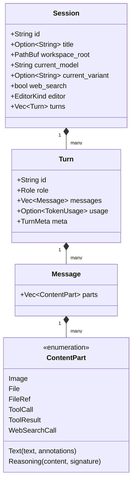

# 领域模型

$$\text{Session} \longrightarrow \text{Turn} \longrightarrow \text{Message} \longrightarrow \text{ContentPart}$$

## 1. 实体

### 1.1 Session（会话根实体）

[`src/model/session.rs`](../src/model/session.rs)。会话的历史上下文边界，`SessionHeader` 持久化以下字段：

| 字段 | 说明 |
|---|---|
| `version` | 会话格式版本（`SESSION_VERSION = 2`，必填）；版本不符的会话不解析 |
| `current_model` / `current_variant` / `web_search` | 当前模型规格、推理档位、联网开关。切换或恢复会话时继承；新会话未指定模型时沿用 `state.json`（见 [config-reference §5.3](config-reference.md#53-档位记忆)） |
| `editor` | 文件编辑协议 `EditorKind`，必填。创建时取模型 `annotation.editor` → `settings.editor` → `patch`，会话内换模不改写，保证工具协议与历史工具结果一致 |
| `workspace_root` | 工作区路径，用于按工程过滤会话 |
| agent space 字段（均可缺省，旧 JSONL 照常加载） | `kind`（`Topic` 缺省不序列化 / `Oneshot` / `Curator`）、`origin{channel, chat_id}`、`routed_by`、`continued_from`（rollover 接替会话所承接的旧会话，不借用 subagent 的 `parent`）、`superseded_by`、`last_activity`（TTL 依据）；详见 [agent](agent.md) |
| subagent 标记 | `parent` / `agent` / `depth` |
| `curation_requested` | 沉淀请求标记，缺省 `false` 且省略序列化；工具与生命周期规则见 [agent §4.3](agent.md#43-curator知识沉淀) |

`SessionSummary` 仅带出 `kind` / `origin` / `superseded_by` 等列表所需字段。

**编辑协议与文件工具集**（工具名常量见 [`src/tools/names.rs`](../src/tools/names.rs)，各协议注册的名字互不重叠）：

| 协议 | 工具 |
|---|---|
| `replace` | `Read` / `Write` / `Edit` / `Glob` / `Grep` |
| `patch` | `Read` / `apply_patch`（Codex V4A，freeform）/ `Glob` / `Grep` |
| `hashline` | `hashline_read` / `hashline_grep` / `hashline_edit`（`[PATH#TAG]` 快照 + 行号补丁，freeform）/ `Glob` |

### 1.2 Turn（轮次）

[`src/model/turn.rs`](../src/model/turn.rs)。交互与计费结算锚点，身份与元数据的唯一归属层：

- `role: Role`（`User` / `Assistant` / `Tool` / `System`）；
- `usage: TokenUsage`（`prompt_tokens` / `completion_tokens` / `total_tokens` / `cached_tokens` / `reasoning_tokens`）；
- `meta: TurnMeta`，轮次级强类型供应商元数据（§3）。

### 1.3 Message（内容分组）

[`src/model/message.rs`](../src/model/message.rs)。值对象，只持有 `parts: Vec<ContentPart>`。角色由所属 `Turn` 确定，供应商原生条目 ID 归 `TurnMeta`，同一事实只有一处表示。

## 2. ContentPart

[`src/model/content.rs`](../src/model/content.rs)。多模态与工具交互均为一等公民：

| 变体 | 字段 | 说明 |
|---|---|---|
| `Text` | `text`, `annotations` | 文本，内嵌引用注脚 |
| `Reasoning` | `content`, `signature` | 思考过程；`signature` 为 Anthropic 防篡改签名 |
| `Image` | `source: MediaSource`, `mime_type` | URL / Base64 / Path |
| `File` | `source`, `mime_type`, `filename` | 当前原生支持 PDF（Anthropic `document` / Gemini `inlineData` / Responses `input_file`） |
| `FileRef` | `path`, `content`, `truncated` | 用户 `@path` 引用的本地文本，harness 提交时展开（提示词原文保留）；二进制 / 超限 / 模型不支持的媒体降级为文本注记；三家适配器经 `format_file_ref` 统一投影为文本块 |
| `ToolCall` | `id`, `name`, `arguments`, `kind` | `kind`：`Function`（arguments 为 JSON 文本，缺省不序列化）/ `Custom`（freeform，arguments 为原始输入文本） |
| `ToolResult` | `tool_call_id`, `content`, `is_error` | 工具结果与错误 |
| `WebSearchCall` | `id`, `query`, `status`, `sources` | 网络检索意图、状态与来源；与 `TurnMeta.output_items` 解耦：前者对齐流式条目完成快照，后者保存 completed 原生 output 供回传 |

音视频变体待实际接入时再引入，避免维护零实现的序列化变体。

### 引用注脚 `Annotation`

参照 OpenAI Responses 规范建模：

- `UrlCitation { url, title, start_index, end_index }`（字符偏移）；
- `FileCitation { file_id, filename, quote, start_index, end_index }`；
- `WebSearchResultLocation`：Anthropic 引用，无字符偏移，以 `cited_text` 摘录定位。

Gemini 的 `groundingChunks` / `groundingSupports` 在适配器层计算字符区间，投射为 `UrlCitation`。

## 3. 强类型供应商元数据

[`src/model/meta.rs`](../src/model/meta.rs)。元数据只存在于轮次级：通用内容供调度与展示，强类型原生数据供对应供应商回传。

| 类型 | 字段 |
|---|---|
| `ResponseTurnMeta` | `response_id`（服务端状态锚点）、`previous_response_id`、`status`、`service_tier`、`reasoning_effort`、`store`（决定 `response_id` 能否链式续接）、`output_items: Vec<ResponseOutputItem>`（原样保留的官方输出条目及 `item_id`，按协议回传） |
| `AnthropicTurnMeta` | `cache_creation_input_tokens`、`cache_read_input_tokens`、`stop_reason`、`content_blocks`（全部原生内容块，含服务端加密字段与 `redacted_thinking`，逐块原样回传） |
| `GeminiTurnMeta` | `finish_reason`、`safety_ratings`、`code_execution_result`（内置代码沙盒输出） |
