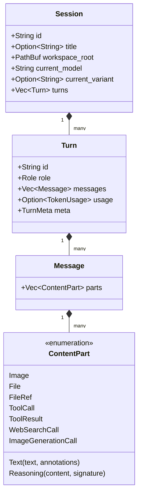

# 领域模型

## 1. 实体

### 1.1 Session

源码 [`crates/vva-core/src/model/session.rs`](../crates/vva-core/src/model/session.rs)。Session 是历史上下文的边界，`SessionHeader` 持久化以下字段：

| 字段 | 说明 |
|---|---|
| `version` | 会话格式版本，当前 `SESSION_VERSION = 3`；版本不符的会话拒绝解析 |
| `id` / `title` / `created_at` | 标识、标题、创建时间 |
| `workspace_root` | 工作区路径，按项目筛选会话 |
| `current_model` / `current_variant` | 模型规格与推理档位；偏好记忆见 [config-reference §5.3](config-reference.md#53-档位记忆) |
| `parent` / `agent` / `depth` | 父会话、agent 定义名、嵌套深度 |
| `continued_from` / `superseded_by` | 续接关系：承接自哪个会话、被哪个会话接替 |

`parent` 表达子会话派生，`continued_from` / `superseded_by` 表达续接，两组关系相互独立。Agent Space 的 rollover 使用续接关系。

会话数据按归属分三处：

| 数据 | 归属 |
|---|---|
| 通用字段 | core `Session` 与 `SessionSummary`，保存为 JSONL |
| 编辑协议、web 开关 | 应用 `CodingSessionConfig` |
| Space 身份、路由、生命周期 | 应用 `SpaceSessionRecord` |

后两者按 SessionId 保存为应用记录，布局见 [storage](storage.md)。应用的 `SessionView` 把 core 快照与应用记录合并，向 TUI / Web 提供扁平的展示字段；`agent_managed()` / `supports_curation()` 只存在于这一层。

**编辑协议与文件工具集**。新会话的编辑协议按模型 `annotation.editor` → `settings.editor` → `patch` 取值，存入应用记录后固定，换模不改写。三种协议注册的工具互不重名，名字常量见 [`crates/vva-core/src/tools/names.rs`](../crates/vva-core/src/tools/names.rs)：

| 协议 | 工具 |
|---|---|
| `replace` | `Read` / `Write` / `Edit`（`old_string` / `new_string`）/ `Glob` / `Grep` |
| `patch` | `Read` / `apply_patch`（Codex V4A，freeform）/ `Glob` / `Grep` |
| `hashline` | `hashline_read` / `hashline_grep` / `hashline_edit`（`[PATH#TAG]` 快照加 `PUT` / `CUT` / `REM` / `MV` / `ADD` 行号补丁，freeform）/ `Glob` |

### 1.2 Turn

源码 [`crates/vva-core/src/model/turn.rs`](../crates/vva-core/src/model/turn.rs)。Turn 是一次交互与计费结算的单位，供应商元数据挂在 Turn 上。

| 字段 | 说明 |
|---|---|
| `role` | `User` / `Assistant` / `Tool` / `System` |
| `usage` | `TokenUsage`：`prompt_tokens`、`completion_tokens`、`total_tokens`、`cached_tokens`、`reasoning_tokens`，以及仅 Responses 使用的 `cache_write_tokens`、`cache_write_tokens_details` |
| `elapsed_ms` | 单次模型响应的耗时 |
| `worked_ms` | 从用户请求开始到最终响应完成的总耗时 |
| `steering` | 用户在执行中插入的引导，延续同一次执行的状态与计时；展示时并入当前运行段 |
| `compaction` | 成功的上下文摘要轮次，后续请求从此轮承接；语义见[压缩上下文](usage.md#压缩上下文) |
| `background_task` | 后台完成投递的任务快照；见 [background_tasks](background_tasks.md) |
| `meta` | `TurnMeta`，供应商元数据，见 §3 |

`steering` 与 `compaction` 为 `false` 时不序列化。

### 1.3 Message

源码 [`crates/vva-core/src/model/message.rs`](../crates/vva-core/src/model/message.rs)。Message 是值对象，只持有 `parts: Vec<ContentPart>`。角色由所属 Turn 的 `role` 确定。供应商原生的条目 ID 归 `TurnMeta`，同一事实只有一处表示。

## 2. ContentPart

源码 [`crates/vva-core/src/model/content.rs`](../crates/vva-core/src/model/content.rs)。多模态内容与工具交互都是一等公民：

| 变体 | 字段 | 说明 |
|---|---|---|
| `Text` | `text`, `annotations` | 文本，可内嵌引用注脚 |
| `Reasoning` | `content`, `signature` | 思考过程；`signature` 是 Anthropic 的防篡改签名 |
| `Image` | `source`, `mime_type` | 图片；`MediaSource` 为 URL / Base64 / Path |
| `File` | `source`, `mime_type`, `filename` | 文件，当前支持 PDF：Anthropic `document`、Gemini `inlineData`、Responses `input_file` |
| `FileRef` | `path`, `content`, `truncated` | `@path` 引用的本地文本 |
| `ToolCall` | `id`, `name`, `arguments`, `kind` | 工具调用；`kind` 为 `Function`（`arguments` 是 JSON 文本）或 `Custom`（freeform，`arguments` 是原始输入文本） |
| `ToolResult` | `tool_call_id`, `content`, `is_error` | 工具结果与错误；另可携带 `background_task_id`、`task`、`shell_output`、`attachments` |
| `WebSearchCall` | `id`, `query`, `action`, `status`, `sources` | 网络检索调用；`action` 为 `Search` / `OpenPage` / `FindInPage` |
| `ImageGenerationCall` | `id`, `status`, `result`, `revised_prompt` | Responses 图像生成调用；`status` 为 `in_progress` / `completed` / `incomplete` |

- `FileRef`：用户输入 `@path` 后，应用 `VvaSessionSetup` 在提交时读入文件内容，提示词原文保留。二进制、超限或模型不支持的媒体转为文本注记。三家适配器经 `format_file_ref` 把 `FileRef` 转为文本块。
- `WebSearchCall`：记录流式条目完成时的快照，供调度与展示。原生 output 条目另存于 `TurnMeta.output_items`，供回传。
- `ToolResult` 的后台任务与 Shell 输出字段见 [background_tasks](background_tasks.md)。

### 引用注脚 Annotation

按 OpenAI Responses 规范建模：

| 变体 | 字段 | 说明 |
|---|---|---|
| `UrlCitation` | `url`, `title`, `start_index`, `end_index` | 网页引用，字符偏移定位 |
| `FileCitation` | `file_id`, `filename`, `quote`, `start_index`, `end_index` | 文件引用 |
| `WebSearchResultLocation` | `url`, `title`, `cited_text` | Anthropic 引用，以 `cited_text` 定位 |

Gemini 的 `groundingChunks` / `groundingSupports` 由适配器换算成字符区间，映射为 `UrlCitation`。

## 3. 强类型供应商元数据

源码 [`crates/vva-core/src/model/meta.rs`](../crates/vva-core/src/model/meta.rs)。`TurnMeta` 按供应商分为三组，各含 `scope` 字段，记录产出该轮时的模型亲和组。回放时与当前请求的亲和组比较，不一致则原生条目不可复用。

| 类型 | 字段 |
|---|---|
| `ResponseTurnMeta` | `response_id`（服务端状态锚点）、`previous_response_id`、`status`、`service_tier`、`reasoning_effort`、`store`（服务端持久化标记）、`output_items` |
| `AnthropicTurnMeta` | `cache_creation_input_tokens`、`cache_read_input_tokens`、`stop_reason`、`content_blocks` |
| `GeminiTurnMeta` | `finish_reason`、`safety_ratings`、`code_execution_result`、`content_parts` |

- `output_items`：Responses 官方输出条目，含 `item_id`，按协议回传。
- `content_blocks`：Anthropic 全部原生内容块，含服务端加密字段与 `redacted_thinking`，逐块回传。
- `content_parts`：Gemini 原生文本、思考与函数调用块，保留块边界与 `thoughtSignature`。
- `code_execution_result`：Gemini 内置代码沙盒的输出。
- `store` 与连接内续接的关系见 [providers §2.1](providers.md#21-传输与上下文续接)。
