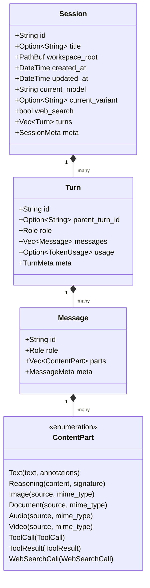

# 领域模型与强类型体系 (Domain Model & Strict Typed Metadata)

## 1. 四层级联领域模型

vva 采用清晰且严格的四层实体架构组织会话生命周期与历史数据：

$$\text{Session} \longrightarrow \text{Turn} \longrightarrow \text{Message} \longrightarrow \text{ContentPart}$$



### 1.1 Session（会话根实体）与 SessionHeader
- **代码位置**：[`src/model/session.rs`](../src/model/session.rs)
- **核心职责**：
  - 作为交互的历史上下文边界；
  - **强绑定当前生效模型、推理强度与网络搜索开启状态**：
    - `current_model: String`（如 `"openai/gpt-5-terra"` 或 `"anthropic/claude-3-7-sonnet"`）；
    - `current_variant: Option<String>`（如 `Some("high")` 或 `None`）；
    - `web_search: bool`（保持工具/函数挂载与 prompt cache 一致）；
  - 无论何时断点恢复、切换会话，都能自动继承历史记录中最近保存的模型、推理强度与网络搜索状态；
  - 携带工作空间路径 `workspace_root: PathBuf`，支持基于工程的工作空间会话过滤。

### 1.2 Turn（轮次实体）
- **代码位置**：[`src/model/turn.rs`](../src/model/turn.rs)
- **核心职责**：
  - 交互轮次与计费结算锚点；
  - 支持分支历史：携带可选的 `parent_turn_id: Option<String>`；
  - 角色归属：`role: Role`（`User`, `Assistant`, `Tool`, `System`）；
  - 包含该轮次的 Token 核算：[`TokenUsage`](../src/model/turn.rs)（`prompt_tokens`, `completion_tokens`, `total_tokens`, `cached_tokens`, `reasoning_tokens`）；
  - 承载轮次级强类型供应商元数据：`meta: TurnMeta`。

### 1.3 Message（消息实体）
- **代码位置**：[`src/model/message.rs`](../src/model/message.rs)
- **核心职责**：
  - 标准通信协议消息单元，拥有全局唯一 `id`；
  - 包含多模态内容块流：`parts: Vec<ContentPart>`；
  - 承载消息级强类型供应商元数据：`meta: MessageMeta`。

---

## 2. ContentPart：多模态与工具调用一等公民

代码位置：[`src/model/content.rs`](../src/model/content.rs)

在 vva 中，所有多模态内容与工具交互均被作为一等公民处理：

| 变体 | 字段定义 | 核心功能与厂商原生映射 |
|---|---|---|
| `Text` | `text: String`, `annotations: Vec<Annotation>` | 纯文本内容，内嵌引用注脚系统 |
| `Reasoning` | `content: String`, `signature: Option<String>` | 深度思考过程。携带可选的数字签名 `signature`（Anthropic 官方防篡改签名） |
| `Image` | `source: MediaSource`, `mime_type: String` | 支持 URL、Base64 或本地文件路径的多模态图像 |
| `Document` | `source: MediaSource`, `mime_type: String` | 支持 PDF、文档解析的专用多模态内容 |
| `Audio` | `source: MediaSource`, `mime_type: String` | 语音与音频输入 |
| `Video` | `source: MediaSource`, `mime_type: String` | 视频多模态输入 |
| `ToolCall` | `ToolCall` (`id`, `name`, `arguments`) | Agent 工具调用请求封装 |
| `ToolResult` | `ToolResult` (`tool_call_id`, `content`, `is_error`) | Agent 工具执行结果与错误封装 |
| `WebSearchCall` | `WebSearchCall` (`id`, `query`, `status`, `sources`) | 结构化记录网络检索意图、状态与引文数据源 |

### 结构化引用注脚系统 (Annotation)
统一参考 OpenAI Responses 规范建立注脚模型：
```rust
pub enum Annotation {
    UrlCitation {
        url: String,
        title: String,
        start_index: usize, // 字符起始偏移
        end_index: usize,   // 字符结束偏移
    },
    FileCitation {
        file_id: String,
        filename: String,
        quote: Option<String>,
        start_index: usize,
        end_index: usize,
    },
}
```
Gemini 原生的 `groundingChunks` 与 `groundingSupports` 在适配器层直接计算字符索引范围，统一投射为 `Annotation::UrlCitation`。

---

## 3. 强类型供应商元数据设计 (Strict Typed Meta)

代码位置：[`src/model/meta.rs`](../src/model/meta.rs)

严禁退化为弱类型的 `HashMap<String, serde_json::Value>`。整个系统按四层层级结构精确注入三家供应商的强类型数据：

### 3.1 OpenAI Responses API 元数据
- **`ResponseTurnMeta`**：
  - `response_id: String`：服务端状态追踪核心锚点；
  - `previous_response_id: Option<String>`：上一轮响应 ID，用于增量对话继承；
  - `status: Option<String>`：响应状态（如 `completed`, `in_progress`）；
  - `service_tier: Option<String>`：服务档位；
  - `system_fingerprint: Option<String>`：后端系统指纹；
  - `reasoning_effort: Option<String>`：推理强度（`minimal`, `low`, `medium`, `high`, `xhigh` 等）。
- **`ResponseMessageMeta`**：
  - `item_id: Option<String>`：Responses 报文中各条消息的唯一条目 ID。

### 3.2 Anthropic Messages API 元数据
- **`AnthropicTurnMeta`**：
  - `cache_creation_input_tokens: Option<u32>`：本次请求创建缓存的 Token 数；
  - `cache_read_input_tokens: Option<u32>`：本次请求命中并读取缓存的 Token 数；
  - `stop_reason: Option<String>`：停止原因（`end_turn`, `tool_use`, `max_tokens` 等）。
- **`AnthropicMessageMeta`**：
  - `ephemeral_cache: bool`：该消息是否显式注入 `cache_control: {"type": "ephemeral"}`。

### 3.3 Google Gemini API 元数据
- **`GeminiTurnMeta`**：
  - `finish_reason: Option<String>`：完成原因（`STOP`, `SAFETY`, `MAX_TOKENS`）；
  - `safety_ratings: Vec<GeminiSafetyRating>`：安全评级指标列表；
  - `code_execution_result: Option<GeminiCodeExecutionResult>`：Gemini 内置代码沙盒执行输出。
- **`GeminiMessageMeta`**：
  - `thought_signature: Option<String>`：思考块的专属标识或签名。
